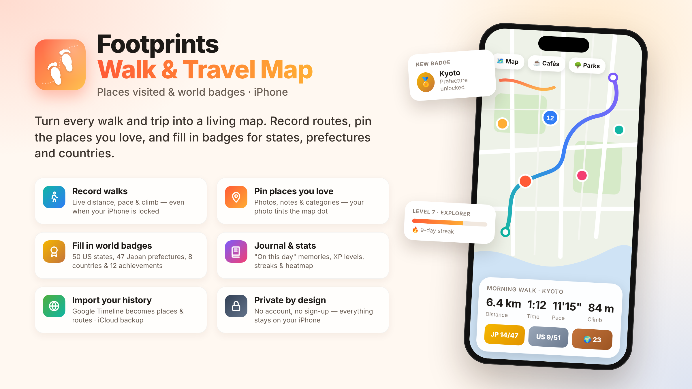

# Footprints: Walk & Travel Map

**Places visited & world badges**



Turn every walk and trip into a living map. Record routes, pin the places you love, and fill in badges for states, prefectures and countries as you explore.

Every walk you take and every place you discover, drawn on one beautiful map of your life. Footprints records your walks, pins the places that matter to you, and turns your travels into badges you can fill in — state by state, prefecture by prefecture, country by country.

## Features

### Walk and watch your map grow
- Record walks with live distance, time, pace and climb
- Keeps recording while your iPhone is locked
- Every route is drawn on your map in a vivid gradient
- Pin a café or a view mid-walk without stopping
- See the elevation profile of each walk
- Share a beautiful route card with friends

### Pin the places you love
- Search any café, park, museum or address
- Long-press anywhere on the map to drop a pin
- Add a photo, a note and a category
- Your photo's colors tint the dot on your map
- Mark favorites and track how often you return

### Fill in the world with badges
- Detailed regional badges for the United States (all 50 states + DC), Japan (47 prefectures), South Korea, Taiwan, Canada, France, the United Kingdom and Morocco
- A US tile map that lights up as you visit each state
- World Explorer progress across every continent
- 12 achievements with bronze, silver and gold tiers: distance, streaks, countries, early-bird walks and more

### Your journal and stats
- A searchable journal of every walk and place, grouped by month
- "On this day" memories from past years
- Level up as you explore, with XP for walks, places, regions and countries
- Weekly distance chart, activity heatmap and streaks
- Personal records and your favorite regions

### A real, detailed map
- Apple Maps, OpenStreetMap street map, satellite imagery and more
- Pinch, zoom and search anywhere in the world
- Thousands of places stay fast with smart clustering

### Bring your history with you
- Import your Google Timeline export — visits become places, walks become routes
- Back up and restore your footprints with Files or iCloud Drive

### Private by design
- No account, no sign-up
- Your walks, places and photos are stored on your iPhone
- Backups go only where you choose

*Start with one walk. Look back on a whole life of footprints.*

## Project structure

```
oct2.xcodeproj          Xcode project
Footprints-Info.plist   App Info.plist (AdMob app id, permissions)
oct2/
  App/                  App entry point, root view, app model
  DesignSystem/         Theme, formatting and shared UI components
  Features/             Map, Record, Walks, Places, Journal, Badges, Profile, Settings, Onboarding
  Models/               Walk, Place and geo models
  Badges/               Region catalog and badge engine
  Services/             Walk recorder, region resolver, Google Timeline importer, backup, ads, caches
  Assets.xcassets/      App icon (light and dark) and accent color
```

## Building

1. Open `oct2.xcodeproj` in Xcode 26 or later.
2. Let Swift Package Manager resolve the Google Mobile Ads SDK.
3. Select your development team under *Signing & Capabilities*, then build and run on an iPhone (iOS 26.2+).

## Ads

Footprints shows AdMob app open and interstitial ads (never while a walk is recording). The AdMob app ID is in `Footprints-Info.plist` (`GADApplicationIdentifier`) and the ad unit IDs are in `oct2/Services/AdManager.swift` (`AdConfig`). When testing on your own device, register it as a test device in AdMob so you never tap live ads.

## Keywords

tracker · journal · countries · states · scratch · diary · route · gps · trip · memories · timeline · explore · hike · been
